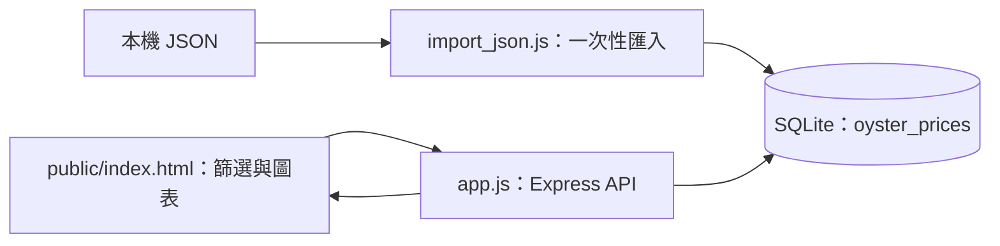

# 漁產價格圖表｜web_hw4

## 系統簡介

以本機 JSON、SQLite 與 Express 建立資料查詢練習，前端依魚種與日期顯示價格及 Chart.js 趨勢圖。這是課程練習版，不是即時行情或正式部署服務。

| 項目 | 說明 |
| --- | --- |
| 前端 | HTML、原生 JavaScript、Chart.js |
| 後端 | Node.js、Express、sqlite3 |
| 資料 | 隨附 JSON 與 `db/sqlite.db` |
| 正確啟動入口 | `node app.js`，不是目前的 `npm start` |

## 使用情境與開發動機

讓使用者不必直接翻閱 JSON 資料，就能選擇魚種及日期、查看價格與歷史走勢。這個版本聚焦「資料匯入 → API 讀取 → 前端篩選 → 圖表呈現」的完整資料流程，不是自動更新的行情平台。

## 核心功能

| 功能 | 說明 |
| --- | --- |
| 價格資料 API | 從 SQLite 查詢並回傳價格資料列。 |
| 魚種清單 API | 提供不重複魚種名稱；目前前端仍使用固定選項清單。 |
| 前端條件篩選 | 依魚種與日期在瀏覽器挑選價格。 |
| 日期轉換與圖表 | 將支援的民國年月轉成西元顯示，使用 Chart.js 畫折線圖。 |
| JSON 匯入工具 | 建立資料表並追加紀錄；重複執行不會自動去重。 |

## 系統架構



匯入工具與 HTTP 程式都操作 `db/sqlite.db`。目前前端會一次取得所有價格，再在瀏覽器篩選；尚未實作伺服器端分頁與條件查詢。

## API 文件

- `GET /api/prices`：讀取 `oyster_prices` 所有資料列。
- `GET /api/fish-list`：讀取不重複的魚種名稱陣列。
- 前端讀取全部價格後，在瀏覽器依魚種與日期篩選；目前魚種選項為固定清單，沒有使用魚種清單 API。
- 民國年月轉西元年月顯示，繪製折線圖。

## 本機啟動

需要 Node.js、npm 與可安裝鎖檔中 `sqlite3` 原生模組的環境；未宣告或驗證 Node engines 相容矩陣。

```bash
git clone https://github.com/Ct2510/web_hw4.git
cd web_hw4
npm ci
node app.js
```

開啟 <http://127.0.0.1:3000/>。請從專案根目錄啟動，因資料庫路徑是相對路徑。Chart.js 使用 CDN，需要網路。

**本專案已追蹤一份資料庫及 journal 檔。先使用自己的副本，不要在有需要的資料上重複執行匯入。** 若查詢失敗，請先確認 `oyster_prices` 是否存在；本次未驗證隨附資料庫的完整性。

目前 `package.json` 的 `npm start` 指向不存在的 `bin/www`。本次依文件整理授權不改功能，故明確使用實際會啟動服務的 `node app.js`。

伺服器監聽固定 3000，未明確只綁定 loopback，且 CORS 開放；**只在受控本機環境展示，不要對外轉發**。若 3000 已被其他程式使用，請先停止你確認可停止的服務，或另行修改／驗證連接埠設定。

## 資料匯入（只供全新空資料庫）

[import_json.js](import_json.js) 與 [import_oyster_prices.js](import_oyster_prices.js) 都會讀取同一 JSON，建立資料表並追加紀錄，**沒有去重或覆寫保護**。

只有在已備份、確認是全新空資料庫的副本中，才選一支執行，例如：

```bash
node import_json.js
```

不要接著再執行另一支，也不要為了重新整理頁面而重跑；那會重複匯入。匯入完成訊息也不是完整的資料品質驗證。

## 目錄導覽

| 路徑 | 用途 |
| --- | --- |
| [app.js](app.js) | 靜態網站、API 及 HTTP 監聽 |
| [db.js](db.js) | 供匯入工具使用的資料庫連線 |
| [public/index.html](public/index.html) | 篩選表單、Fetch 與圖表 |
| [來源 JSON](3f22734f46b814a22e7585dc6b1cea99_export.json) | 隨附資料快照 |
| [db/](db/) | 現有資料庫與 journal |
| [package.json](package.json)、[package-lock.json](package-lock.json) | 依賴與鎖檔 |

## 驗證與已知限制

- 沒有自動測試腳本；本次只核對程式與文件，未重新安裝、啟動、匯入或完成瀏覽器驗收。
- 可手動檢查 API 是否回傳陣列、日期轉換、魚種篩選、空結果及圖表；尚未實作分頁、身分驗證或即時外部資料更新。
- Repository 已追蹤 `node_modules/`、`.idea/`、資料庫與 journal；本次只補 README，不刪檔或改歷史。後續應另行確認 .gitignore 與既有追蹤檔案的清理方式。
- 資料發布來源、授權與更新日期未完整記錄；不宣稱即時、官方認證或可任意再散布。
